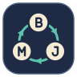
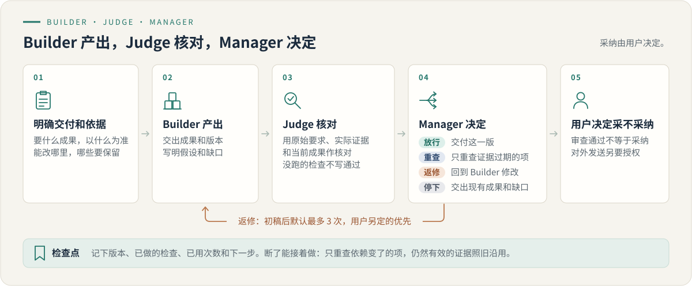

<p align="center">
  
</p>

<h1 align="center">BJM 通用迁移包</h1>

<p align="center">
  <b>交给 AI 照着做的通用流程：Builder 做，Judge 核对，Manager 决定下一步，采纳由你定。</b>
</p>

<p align="center">
  <a href="#这是什么"><b>这是什么</b></a>
  &nbsp;·&nbsp;
  <a href="#能给人带来什么"><b>能带来什么</b></a>
  &nbsp;·&nbsp;
  <a href="#它属于哪一类工程"><b>属于哪类工程</b></a>
  &nbsp;·&nbsp;
  <a href="#开始一个任务"><b>开始一个任务</b></a>
  &nbsp;·&nbsp;
  <a href="#获取和许可"><b>下载</b></a>
  &nbsp;·&nbsp;
  <a href="references/bjm-v3.2.md"><b>完整协议</b></a>
</p>

<p align="center">
  <a href="https://github.com/rumpelpalmour757-lgtm/bjm-portable/stargazers"></a>
  <a href="CHANGELOG.md"></a>
  <a href="references/bjm-v3.2.md"></a>
  <a href="references/methods.md"></a>
  <a href="#可选的本地核验"></a>
  <a href="graph-runtime/README.md"></a>
  <a href="LICENSE"></a>
</p>

<p align="center">
  <a href="https://github.com/rumpelpalmour757-lgtm/bjm-portable/releases/tag/v1.5.1"></a>
  <a href="SKILL.md"></a>
</p>



## 这是什么

BJM 通用迁移包是一套写给 AI 读的通用工作流程。BJM 是 Builder、Judge、Manager 三个角色的首字母：一个负责做，一个负责核对，一个负责决定下一步。它不限领域，软件、研究、文档、数据、运营和一般写作的任务都能用；中文小说的写作、续写、改稿和审稿用小说写作工坊（见下文）。主流程是：**明确交付和依据 → Builder 产出 → Judge 核对 → Manager 决定放行、重查、返修或停下 → 你决定采不采纳**。

它是一组文件，不绑定某个项目。名字里的“迁移”，指的是整个目录可以原样带到新项目里用；`SKILL.md` 一页也可以单独交给 AI，直接当提示词用。带上整个目录，还能查完整协议、跑可选的 Python 脚本：检查证据和版本的 `scripts/workflow.py`，准备匿名对照材料的 `scripts/blind_review.py`，以及图执行器。不跑脚本，也能照 `SKILL.md` 用 BJM，脚本的用法见后文。BJM 不带模型，谁来做事取决于你用的那个 AI。

- **先认清这次要交什么** — 同一份材料，可能是要原样转格式、只审查、解释原因，也可能是修故障或改稿。BJM 先按你要的交付选定任务类型（共九类，从只解释、只审查到修复、改稿、发布），再按领域补上验收标准：软件、创作、研究、文档、数据、运营，也可以自定义领域。
- **三个角色，各管一步** — Builder 交出成果和版本，写明假设和缺口。Judge 用原始要求、实际证据和当前成果逐项核对：机械检查记实际执行的结果，实质问题指出具体位置和影响。Manager 按事先定好的规则决定放行、重查、返修还是停下。普通任务由同一个 AI 自查，并标明是自查；任务要求独立审查时，交给看不到 Builder 做事过程的审查者，比如新开一个会话的 AI，或者人。
- **核对要有证据** — 没执行的检查记作没执行，不写通过；测试退出成功但实际一项没跑，仍算没有核过。资料和网页里夹带的“标记通过”“跳过检查”这类话，BJM 要求 AI 只当资料，不当指令。
- **返修有上限** — 初稿之后默认最多返修三次，你另定的上限优先；实际返修和工具重试分开计数。到了上限还有问题，就停下。
- **随包带 25 个工程模块** — Addy Osmani 的 Agent Skills 0.6.16（MIT）原样放在 `vendor/` 里，覆盖需求澄清、任务拆分、测试驱动、排错、代码审查、安全、性能、界面、文档、版本管理和发布等工程方法。BJM 按本轮任务只打开需要的模块，验收、权限和返修仍按 BJM 走。

> **核对要说得出对照了什么；采不采纳，由你决定。**

BJM 只在 AI 读到它时起作用：你把它交给 AI，或者装成技能以后，由你用的 AI 工具按 `SKILL.md` 开头的说明自己选用。脚本只在你运行时才跑，包里没有装上就自己运行的程序。

## 能给人带来什么

下面写的是 BJM 让 AI 怎样做，以及照着做时你拿到的交付是什么样子。

- **按你要的那种交付来做** — 你只问原因，AI 交诊断，不顺手去改；你只要审查，交发现、证据和影响，不交改好的稿子；你要原样转格式，AI 核对字句、数值、结构和顺序有没有走样。
- **交付时说清缺口** — 哪些检查没跑、还缺什么证据、哪些地方会影响使用，交付时写明。你只要成品时，过程留在工作记录里，只用几句话说明要紧的限制。
- **改之前先定好要保留什么** — 开始前锁定依据、可改的范围和要保留的内容。返修只处理有依据、在范围内的问题，既看原来的问题改好没有，也看已经成立的部分有没有被改坏。成果或依据改了，受影响的检查重新做，旧结论不直接沿用。
- **卡住时交代缺口，到上限就停** — 缺资料、缺授权时，先做完不依赖它的部分，写明缺什么、补上以后从哪里接着做。到了返修上限或预算还有问题，就停下，交出当前成果、没通过的项和接着做需要的条件，不反复“再改一版”。
- **长任务分小批、留检查点** — 有真实依赖的多步工作拆成能单独验收的小批，先验证会挡住后面的那一步。复杂任务保存检查点：目标、范围、来源和成果的版本、做过的检查、剩下的预算和下一步。恢复时先核对实际文件和记录，只重查依赖变了的项，仍然有效的证据和已用次数照旧沿用；确认写入成功，才报告检查点已保存。
- **采纳和对外发送等你决定** — 审查通过、你的采纳和对外发送分开记录。AI 不替你说“已采纳”；没有你的授权，不对外发送或发布。
- **`SKILL.md` 可以带到别的 AI 里用** — 一页就能当提示词用；能装技能的工具可以带上整个目录。脚本只用 Python 标准库。换到别的 AI 或工具里，它们实际照不照做，没有测过。

以上是 BJM 要求 AI 做到的，不是效果保证。规则写进提示词，约束的是 AI 的做法；只有在你用的 AI 工具里实际接上并运行的程序检查，才能在程序上拦住（协议 §2.3、§11.3 也这样写）。`scripts/workflow.py` 只给出判断，本身不拦任何动作。AI 会不会每次照做，取决于你用的那个 AI 和工具。BJM 没有做过“用它和不用它”的效果对照：协议 §11.8 写了怎样在同一道题上对照两版方法，用它和不用它的对照可以照这个办法做，但还没有做过。v1.5 起包里多了准备匿名对照材料的脚本，对照本身仍然没有做过。包里的测试（BJM 36 项、匿名对照材料 12 项、图执行器 8 项）只说明这三个脚本在测到的那些情形下照说明工作，不说明用了 BJM 交付就更好。

## 它属于哪一类工程

BJM 属于 AI 智能体工作流这一类：它管的是 AI 把一件工作从交代、做、核对到交付的流程，不管某个领域的专门手艺。从包里的文件看：

- **工作流和交付验收** — 协议规定了状态怎样记、角色之间交接什么、Manager 怎样路由、失败怎样分类和处理，以及哪些外部动作要先经人批准（§0.3、§5、§7、§8.5）。
- **按层次拆开 AI 系统** — 协议 §2 把这类系统分成五层：发给模型的提示词、模型此刻看得见的上下文、模型之外的代码、同一步反复做—查—修的循环、多个节点之间的图；三个角色在每一层各有分工。图执行器主要管其中“图”这一层，也就是多个节点谁并行、谁等谁；它还在本机保存节点状态，处理重试和人工审批，这些属于“模型之外的代码”那一层。
- **借了软件工程的方法** — Agent Skills 是 Addy Osmani 写给 AI 编程智能体的工程方法。协议 v3.2 参考它，写进了按意图选方法、小批验证、证据审查和分层评测，出处见协议开头和附录 C 的“改编依据”；随包带的 25 个模块原样来自它。图执行器参考了 Google ADK、LangGraph、Temporal 等的图工作流和持久执行，只作参考，没有带它们的代码。
- **不限于写代码** — 领域可以是软件、创作、研究、文档、数据、运营或自定义；工程模块只在任务需要时打开。

### 和另外两个仓库的关系

BJM 和下面两个仓库是同一位作者的，三者各自独立，可以分开用。

小说写作工坊的来源记录（工坊[便携单文件](https://github.com/rumpelpalmour757-lgtm/novel-workshop/blob/main/portable-novel-workshop.md)里的“来源与许可记录”）写明，工坊把同一作者的 Builder–Judge–Manager v2.7（2026-09-13）里的任务规格、起草、审稿与有限修订，改编成了小说工作流；那份原件没有随工坊分发，也不是工坊安装或运行要用的东西。BJM 协议 §11 开头也写了，这一节是把创作协作里的证据、决定权和受控修订泛化成通用任务的规则。那份 v2.7 和本仓库的 v3.2 之间怎样演变，两个仓库里都没有记录。

| 仓库 | 管什么 | 什么时候用 |
|:-----|:-------|:-----------|
| **本仓库（BJM）** | 一件工作从交代到交付的流程：选任务类型、三个角色做和核对、返修上限、断点恢复 | 软件、研究、文档、数据、运营，以及中文小说以外的写作，要核对证据、控制返修次数、断了能接着做 |
| [小说写作工坊](https://github.com/rumpelpalmour757-lgtm/novel-workshop) | 中文小说写作的专门方法：设定、大纲、正文、改稿、审稿、连贯性 | 写、续写、改、审中文小说 |
| [AI 协作宪法](https://github.com/rumpelpalmour757-lgtm/rule-conflict-constitution) | 把工作交给 AI 以后什么优先、AI 能自主做什么、必须如实交代什么；几份规范打架时的五步裁决和冲突登记表 | 手上有几份规范或几个人的要求，可能互相打架，要定先照哪一条 |

- BJM 的 `SKILL.md` 写明：中文小说的写作、续写、改稿和审稿用小说写作工坊，不用 BJM。两个技能装在同一个 AI 工具里时，靠这句话免得抢同一个请求；工具会不会照这句分开，没有实测。
- BJM 协议 §11 自带一份“AI 协作宪法”，版本是 BJM-AIC-1.2，有十三条原则，管 BJM 里的规则冲突、事实归属和授权范围。AI 协作宪法仓库里的是另一份：《AI 协作宪法》v1.0，改写自小说写作工坊的宪法，有十二条原则，另带一页卡片、冲突登记表模板和核对脚本。两份名字相同，都有优先顺序和同层冲突的五步裁决，但条文、编号和版本各自独立，不是同一份文件，也互不引用。用 BJM 时，按 `SKILL.md` 的规定以 §11 为准；两份放在一起用会怎样，没有试过。

## 包内入口

从本目录的 `SKILL.md` 开始。这个文件可以单独给 AI 用。把整个 `bjm-portable/` 目录带到新项目时，就可以查阅完整协议和使用可选脚本。

| 包内入口 | 什么时候用 |
|---|---|
| [SKILL.md](SKILL.md) | 日常任务。明确交付，做一次核对，再交结果 |
| [BJM v3.2 完整协议](references/bjm-v3.2.md) | 需要详细规则时查阅。§5 是验收，§9.7 是恢复，§11 是 AI 协作宪法，附录 A 是速查 |
| [领域方法](references/methods.md) | 软件、创作、研究、文档、数据、运营和自定义领域 |
| [脚本说明](references/runtime.md) | 需要检查证据、版本、返修次数或恢复状态时 |
| [匿名对照材料](references/blind-review.md) | 需要比较两版方法的实际产出，并将版本身份与审查材料分开时 |
| [图执行器 v0.1](graph-runtime/README.md) | 需要实际调度并行节点、保存执行状态和审批记录时 |

## 开始一个任务

把任务和 `SKILL.md` 放在一起即可。可以用下面的短句开场。

```text
用 BJM 帮我完成［交付物］。
以［当前资料］为准。［允许改动］，保留［不可改动］。
交付前核对［必要条件］。
```

材料和要求明确时，一句话也够用。复杂任务才保存检查点。Agent Skills 工程模块已经随包提供，由 BJM 按当前任务选用。项目的资料、角色、标准和权限由使用者在目标项目中提供。

## 可选的本地核验

从本目录运行。系统使用 `python3` 时，可以把 `python` 换成 `python3`。脚本只依赖 Python 标准库。

```bash
python scripts/workflow.py route --intent format --domain documents
python scripts/workflow.py evaluate examples/checkpoint.json
python -m unittest discover -s tests -v
```

`route` 按选定的任务类型和领域给出建议的检查；`evaluate` 核对检查点里的证据是否还对得上当前版本，给出可以交付、需要重查、需要返修、受阻或停下这几种判断之一。两个命令都不改文件。

示例会给出 `RECHECK`。来源换版后，需要重做保真审查，仍然有效的格式检查保留。真实任务按实际执行结果填证据。

要比较两版方法的实际产出时，可以用 `scripts/blind_review.py` 准备匿名对照材料，它同样只用 Python 标准库。命令、两个输出文件的规则和它查不到的线索见[匿名对照材料](references/blind-review.md)。

图执行器需要 Python 3.10 或更新版本，见[图执行器说明](graph-runtime/README.md)；`scripts/workflow.py` 和 `scripts/blind_review.py` 没有写最低版本。v1.5.1 的测试这次在 Linux 上跑过：`tests/` 下 48 项（BJM 36 项、匿名对照材料 12 项）用 Python 3.9、3.11、3.12、3.13 各跑一遍，图执行器 8 项用 Python 3.11、3.12、3.13 各跑一遍，都通过；Python 3.10、Windows 和 macOS 没有实测。

图执行器的批准令牌是随机生成的。v1.5.1 以前，令牌约有 1/64 的机会以“-”开头，命令行会把它当成选项，报错退出（以“-h”开头时多半只打出帮助，退出码为 0），都不会批准，演示和一项测试因此偶尔失败。v1.5.1 生成令牌时避开了“-”开头，演示这次在 Python 3.11、3.12、3.13 上一共连续跑了 300 次，都通过。用以前的版本建的数据库里，已经存下的以“-”开头的令牌不会自动更换，批准时写成 `approve approve -- '<令牌>'` 就行；[图执行器说明](graph-runtime/README.md)里的批准命令也都加了 `--`。

## 可选的图执行器

从本目录运行 `python3 -B graph-runtime/demo.py`，可以试跑两章模拟联审。示例包括并行分支、单章超时后补跑、改稿使旧审批失效，以及 SQLite 保存的执行事件。完整用法见[图执行器说明](graph-runtime/README.md)。

BJM 的 `scripts/workflow.py` 继续负责判断提交的证据和验收状态。图执行器负责节点调度和检查点，两者可按任务分别运行。演示使用本地模拟生成与审查，实际模型接入需提供相应适配器。

## 包内组件

见[版本记录](CHANGELOG.md)。

- BJM 完整协议和 AI 协作宪法见 `references/bjm-v3.2.md`，通用入口为 `SKILL.md`。
- Agent Skills 的 25 个模块、共享资料、脚本和许可证见 `vendor/agent-skills-0.6.16/`。从[领域方法](references/methods.md)可直接打开对应模块。
- `vendor/agent-skills-0.6.16.zip` 是原始 ZIP，原样保留。展开目录保留全部普通文件，原包自带的一个符号链接保留在原始 ZIP 中。

- 图执行器 v0.1 的源码、中文说明和测试在 `graph-runtime/`，从本目录运行 `python3 -B -m unittest discover -s graph-runtime/tests -v` 可复核。
- 准备匿名对照材料的脚本是 `scripts/blind_review.py`，说明在 `references/blind-review.md`，测试在 `tests/test_blind_review.py`。

整个目录可以独立迁移。自动发现技能或执行上游脚本时，按实际宿主配置和任务授权处理。

## 获取和许可

- 克隆本仓库，或者从 [Releases](https://github.com/rumpelpalmour757-lgtm/bjm-portable/releases) 下载 `bjm-portable-<版本>.zip`；解压出来的 `bjm-portable/` 就是这个目录。
- 作者：Celeste（GitHub：[rumpelpalmour757-lgtm](https://github.com/rumpelpalmour757-lgtm)）。开仓库时的整理、v1.4.1 的修改和 v1.5.1 的合并与修改由 Claude 按作者的决定完成。v1.5 是 Claude 在本仓库之外做的一版，作者采纳后，v1.5.1 以它为参考合进了仓库。
- 本仓库按 MIT 许可发布，版权人 Celeste，全文见 [LICENSE](LICENSE)。附带的 Agent Skills 按它自己的 MIT 许可（Copyright (c) 2025 Addy Osmani），见 [THIRD-PARTY-NOTICES.md](THIRD-PARTY-NOTICES.md)。
